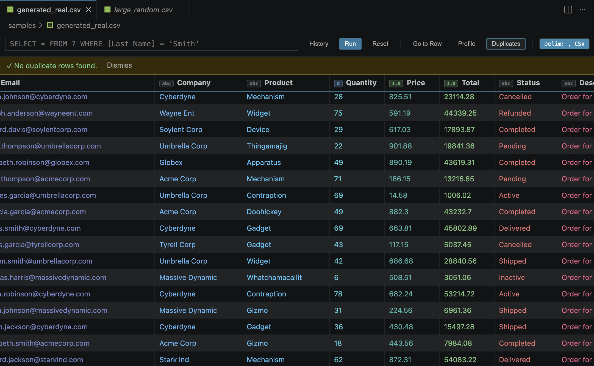
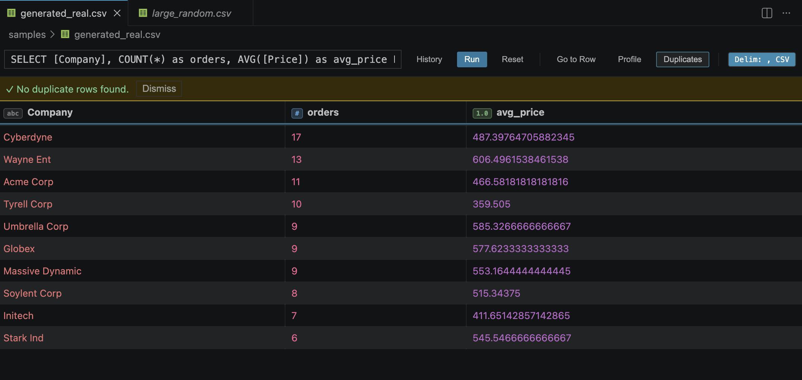
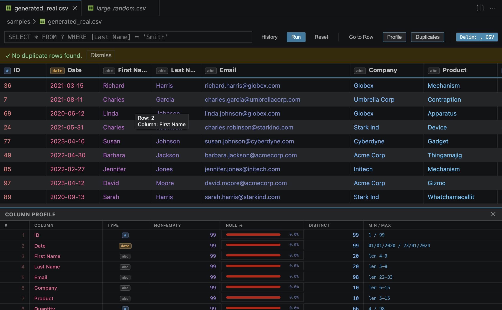
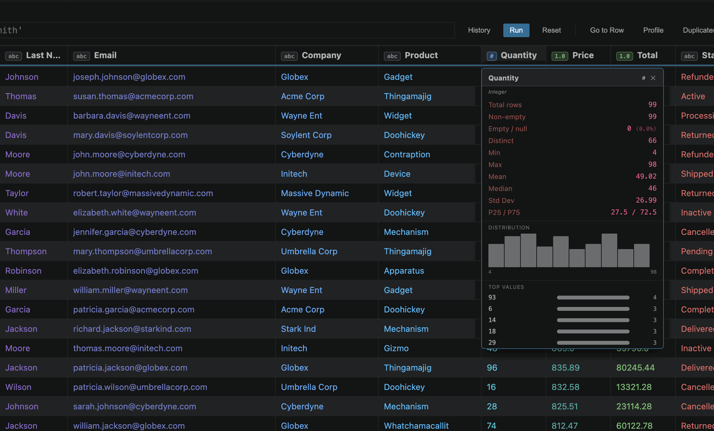
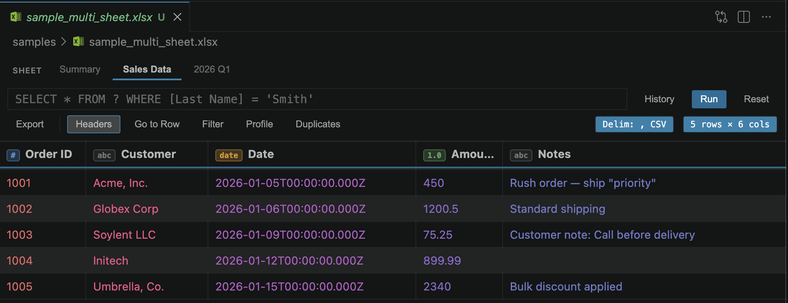
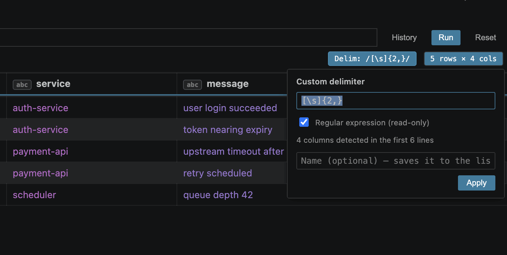

# CSV ClearView — CSV Viewer & Editor with SQL for VS Code

<table>
<tr>
<td valign="middle"><strong>VS Code Marketplace</strong></td>
<td valign="middle"><a href="https://marketplace.visualstudio.com/items?itemName=VinuThomas.csv-clearview"></a> <a href="https://marketplace.visualstudio.com/items?itemName=VinuThomas.csv-clearview"></a> <a href="https://marketplace.visualstudio.com/items?itemName=VinuThomas.csv-clearview&ssr=false#review-details"></a></td>
</tr>
<tr>
<td valign="middle"><strong>Open VSX</strong></td>
<td valign="middle"><a href="https://open-vsx.org/extension/vinuthomas/csv-clearview"></a> <a href="https://open-vsx.org/extension/vinuthomas/csv-clearview"></a></td>
</tr>
</table>

**View, query, and profile CSV files without leaving VS Code — including the big ones.** CSV ClearView opens `.csv`, `.tsv`, `.psv`, and Excel `.xlsx` files in a fast, color-coded grid with real SQL, column statistics, and a duplicate finder built in. Files up to 500MB open fully in the grid, SQL works on files up to about 150–175MB depending on your machine's memory, and anything larger than 500MB opens in a paged view you can scroll end to end, at any size.

Built for data engineers, analysts, and developers who would rather not open Excel or start a Python notebook just to look at a file.



## Why CSV ClearView?

- **🗻 Built for large CSV files** — Virtual scrolling and chunked parsing open files up to 500MB fully in the grid. Past 500MB, Paged View streams rows on demand so even multi-GB files open and scroll. See [Large File Support](#-large-file-support) for what works at each size.
- **🔍 Real SQL, not a lookalike** — Run full `SELECT` statements with `WHERE`, `GROUP BY`, aggregates, and `ORDER BY` against your CSV. The SQL you already know, no new query language to learn.
- **📈 Column profiling without a notebook** — Inferred types, null counts, distinct values, min/max, percentiles, and histograms are one click away. No Python, no pandas, no kernel.
- **🔎 Duplicate row finder** — One click finds every duplicate row, groups matches together, and shows each row's original line number.
- **📗 Excel viewer included** — Open `.xlsx` workbooks in the same grid, with a sheet-tab switcher for multi-sheet files.
- **🔣 Any delimiter, even regex** — Comma, tab, pipe, and semicolon are auto-detected. Multi-character separators like `||`, or a regular expression for space-aligned log files, are one click away.
- **♻️ Non-destructive by default** — Filters, queries, sorting, and duplicate views change what you see, never what's on disk.

## Quick Start

1. **Install** CSV ClearView from the Extensions view (search for `CSV ClearView`).
2. **Open any `.csv`, `.tsv`, `.tab`, `.psv`, or `.xlsx` file** — it opens in the grid automatically.
3. **Query it** — type SQL in the query bar: `SELECT * FROM ? WHERE [Department] = 'Sales' ORDER BY [Salary] DESC`
4. **Explore it** — click **Profile** for a summary of every column, or Shift+click a column header for stats and a histogram.

Have a `.log`, `.txt`, or `.dat` file? Right-click it in the Explorer and choose **Open with CSV ClearView**.

## Screenshots



*Run SQL SELECT queries directly on your CSV. Filter, sort, and aggregate — powered by a full in-memory SQL engine.*



*The Profile panel gives you a complete schema summary at a glance: inferred data types, null percentage, distinct value counts, and min/max ranges for every column.*



*Shift+click any numeric column header to see an instant distribution histogram alongside min, max, mean, median, and percentile stats.*



*Open `.xlsx` files directly — no more converting to CSV first. Multi-sheet workbooks get a sheet-tab switcher right in the toolbar.*



*Not everything is comma-separated. Set a multi-character delimiter such as `||`, or a regular expression, and watch the column count update live before you apply. Here a space-aligned application log is split into clean `timestamp / level / service / message` columns with `[\s]{2,}`.*

## Features

### 🎨 Visual Clarity
- **Colored Columns:** Each column is automatically color-coded for instant visual separation (adapts to dark/light themes)
- **Sticky Header:** Header row stays fixed at the top while scrolling through thousands of rows
- **Alternating Rows:** Zebra-striping for improved row readability
- **Freeze Panes:** Right-click any column header and choose **Freeze pane here** for Excel-style frozen columns
- **Resize Columns:** Drag the right edge of a column header to resize it; double-click the edge to fit the content again

### 🔍 Data Analysis & Profiling
- **SQL Queries:** Run full SQL SELECT statements on your CSV data (powered by AlaSQL)
  - Example: `SELECT * FROM ? WHERE [Price] > 100 ORDER BY [Date] DESC`
  - Query history with bash-style ↑/↓ navigation (stores up to 50 queries)
- **Column Filters:** Click **Filter** to show a per-column filter row — type in any column's box to instantly narrow rows by case-insensitive substring match. Press **Esc** to clear all filters.
- **Column Statistics:** Shift+click any column header for instant stats
  - Numeric: min, max, mean, median, std dev, percentiles, **inline histogram**
  - Date: earliest, latest
  - String: length stats, frequency distribution
  - All: null count, distinct values, top-5 most common values
- **Schema Summary Panel:** Click **Profile** for a complete data dictionary showing type, nulls, distinct count, and ranges for every column
- **Data Type Inference:** Automatic detection of integers, floats, dates, booleans, and strings with visual badges
- **Export:** Click **Export** to save your data via a native save dialog
  - **Full File:** export the entire file to JSON, Markdown table, or HTML table
  - **Current View:** export whatever's currently displayed — filtered rows, sorted order, or SQL query/aggregation results — to CSV, JSON, Markdown, or HTML

### 🔎 Duplicate Detection
- **One-click scan:** Click **Duplicates** to instantly find all duplicate rows across the entire file
- **Grouped view:** "Show only duplicates" hides non-duplicate rows and groups matching rows together with a thin divider between each group
- **Original line numbers:** A **#** column shows the exact CSV line number of every duplicate row so you can find it in the source file immediately
- **Amber highlights:** Duplicate rows are tinted amber in the normal view for quick visual scanning
- **Review or remove:** Dismiss the results to leave your data unchanged, or choose **Remove duplicates** to keep the first of each repeated row. Removal can be undone

### 🧭 Navigation
- **Go to Row:** Jump to any row by number instantly — the target row flashes to confirm navigation
- **Row & Column Count:** A live toolbar badge shows the total rows × columns — and how many rows are hidden when filters or queries are active
- **Error markers:** Visual markers in the scrollbar for quick jumping to parsing errors

### 📊 Large File Support
- **Virtual Scrolling:** Only visible rows are rendered, so large grids stay responsive
- **You choose how to open it:** Files over 20MB (configurable) ask how to open them — **Open Full File**, **Paged View**, **Show Head** / **Show Tail** (the first or last ~256KB of rows, read-only), or **Plain Text**
- **Full grid up to 500MB:** Choose **Open Full File** and every row is loaded into the grid. Edits save on files up to about 100MB; past that, you're told the change can't be saved
- **SQL up to about 150–175MB:** A query sends the whole dataset to VS Code's extension host, which needs roughly 2× the file size in one message plus several times that in memory. The limit is set from your machine's memory — about 160MB of CSV on an 8GB machine, about 175MB on 16GB or more. Past it, the query bar tells you instead of running out of memory; use **Filter**, or **Show Head** / **Show Tail** to query a sample. A query that *returns* too many rows (for example `SELECT *` with no `WHERE`) is stopped the same way
- **Switch mid-load:** If a full load is taking a while, the prompt offers **Paged View** or **Plain Text** so you're never stuck waiting
- **Paged View for anything bigger:** Files over 500MB stream rows on demand from a row index, so multi-GB files open and scroll. Paged View is for browsing — SQL and editing are turned off in this mode
- **Smart Chunking:** Files are processed in chunks to keep VS Code responsive

### ✏️ Editing & Validation
- **In-Place Cell Editing:** Double-click any cell to edit it; **Tab** / **Shift+Tab** move to the next or previous cell. **Ctrl+Z / Ctrl+Y** (Cmd+Z / Cmd+Shift+Z on macOS) undo and redo edits, and **Ctrl+S** saves — like any other VS Code editor, unsaved edits show a dot on the tab and survive a restart
- **Rows & Columns:** Right-click a cell to insert a row above or below, or delete it. Right-click a column header to rename, insert, move, or delete a column. All of it can be undone
- **Clean a Column:** Right-click a column header → **Clean column…** to trim whitespace, change case (UPPERCASE, lowercase, Title Case), fill empty cells, delete rows where the column is empty, or split it into several columns on a separator
- **Remove Duplicates:** After **Duplicates** finds repeated rows, **Remove duplicates** deletes them and keeps the first of each
- **Find & Replace:** Search and replace across the rows in the current view (filters applied)
- **Comment Lines:** Lines starting with `#` (outside quoted fields) are kept out of the grid, SQL, stats and exports, and written back where they were when you save. Change the prefix, or turn this off, with `csvClearView.commentPrefix`
- **Read-only views:** Editing is off for Excel and JSONL files, regex delimiters, Show Head / Show Tail, Paged View, and SQL query results (click **Reset** to edit again)
- **CSV Linting:** Automatic detection of rows with inconsistent column counts and unclosed quotes, marked in the scrollbar
- **Raw File View:** Click **Raw** to flip between the table and the underlying file text — perfect for eyeballing a row with a stray delimiter, then flip back
- **Open in Text Editor:** Parse errors include a one-click button that reopens the file in VS Code's text editor so you can fix the offending line directly

### 🔧 Format Flexibility
- **Excel (.xlsx) Viewing:** Open `.xlsx` workbooks directly — each sheet renders through the same colored grid, SQL query, filter, profile, and export tools as CSV. Multi-sheet workbooks get a **sheet-tab switcher** in the toolbar. Currently read-only (no cell editing or save-back to Excel).
- **JSONL / NDJSON Viewing:** Right-click a `.jsonl` or `.ndjson` file → **Open with CSV ClearView** (or **Reopen Editor With…**) to see it as a table: one row per line, one column per top-level key, nested values shown as JSON. Lines that aren't a JSON object go in a `_raw` column instead of being dropped. Read-only, up to 500MB
- **Auto-Delimiter Detection:** Automatically recognizes comma, tab, pipe, and semicolon delimiters
- **Multi-Character Delimiters:** Files separated by `||`, `::`, `<SEP>` or any other string parse correctly — pick **Custom…** from the delimiter badge. Fully editable and saved back with the same separator
- **Regex Delimiters:** Split on a pattern such as ` {2,}` or `[,;]` for column-aligned logs and mixed-separator exports, with a live column-count preview that warns you when a pattern splits unevenly. Read-only, since a pattern has no single separator to write back
- **Saved Delimiters:** Give a custom delimiter a name and it joins the picker for every file you open. Stored in your VS Code settings, so it follows your profile across workspaces
- **Open Any File:** Use **"Open with CSV ClearView"** (right-click in the Explorer, or the Command Palette) to open `.txt`, `.dat`, `.log`, or any other file in the grid
- **Headerless Files:** Click **Headers** to toggle whether the first row is a header — files without one get generic `Column 1..N` names so filtering and SQL still work
- **Type-Aware Sorting:** Click column headers to sort with intelligent handling of numbers, dates, and strings

## Use Cases

- **Data engineers** — debug ETL pipelines, validate transformations, inspect data quality
- **Data scientists** — quick dataset exploration and ML data validation without starting a kernel
- **Analysts** — ad-hoc SQL queries, statistical summaries, large report inspection
- **Developers** — review database exports and test fixtures, parse log files with regex delimiters
- **SREs / platform engineers** — turn space-aligned log exports, `ps`/`df` dumps, and legacy pipe-delimited feeds into a sortable, queryable grid

## FAQ

### How do I open a large CSV file in VS Code?
Install CSV ClearView and open the file. Files over 20MB ask how you'd like to open them: load the full file into the grid (up to 500MB; SQL up to about 150–175MB), browse it in **Paged View** (any size), preview the first or last ~256KB of rows, or open it as plain text.

### How do I run SQL queries on a CSV file in VS Code?
Open the CSV in CSV ClearView and type a query in the SQL bar at the top of the grid. Use `?` as the table name and brackets for column names: `SELECT [Region], SUM([Sales]) FROM ? GROUP BY [Region]`. Only `SELECT` statements are allowed, so a query can never change your file. SQL works on files up to about 150–175MB, depending on your machine's memory. See the [SQL Query Guide](#sql-query-guide).

### Can I view Excel `.xlsx` files in VS Code?
Yes. `.xlsx` files open in the same grid as CSV files, with a sheet-tab switcher for multi-sheet workbooks. SQL, filters, profiling, and export all work. Excel files are read-only for now.

### How do I find duplicate rows in a CSV file?
Click **Duplicates** in the toolbar. Every duplicate row is highlighted, and **Show only duplicates** groups matching rows together with their original line numbers.

### Does it work with tab, pipe, semicolon, or custom delimiters?
Comma, tab, pipe, and semicolon are detected automatically. For anything else — `||`, `::`, or a regular expression for space-aligned logs — click the **Delim:** badge and choose **Custom…**. See [Delimiters & Log Parsing](#delimiters--log-parsing).

### Does it work in Cursor, Windsurf, or VSCodium?
Yes. CSV ClearView is published on the [Open VSX Registry](https://open-vsx.org/extension/vinuthomas/csv-clearview), which these editors use. Search for `CSV ClearView` in their Extensions view.

### Does CSV ClearView change my file?
Only when you save (Ctrl+S, or auto-save if you have it on) after editing a cell or using Replace — and you can undo those edits first. Sorting, filtering, SQL queries, profiling, and duplicate views only change what you see.

## Configuration

Customize CSV ClearView through VS Code settings:

| Setting | Default | Description |
|---------|---------|-------------|
| `csvClearView.stickyHeader` | `true` | Keep header row fixed at top while scrolling |
| `csvClearView.firstRowIsHeader` | `true` | Treat the first row as a header; when `false`, generic `Column 1..N` names are used and the first row is shown as data |
| `csvClearView.commentPrefix` | `#` | Lines starting with this are comments: hidden from the grid and kept when you save. Empty string turns it off. Not applied in Paged View |
| `csvClearView.alternatingRows` | `true` | Enable zebra-stripe row coloring |
| `csvClearView.safeModeThreshold` | `20` | File size (MB) above which you're asked how to open the file (full, paged, head, tail, or plain text) |
| `csvClearView.showSlowLoadPrompt` | `true` | When the grid takes too long to render, offer to switch to Paged View or Plain Text |
| `csvClearView.forceTextColumnColoring` | `false` | Force column coloring in Plain Text mode (may impact performance) |
| `csvClearView.delimiter` | `auto` | Delimiter: `auto`, a single character (`,`, `\t`, `\|`, `;`), a multi-character string (`\|\|`, `::`), or a regex when `delimiterIsRegex` is on |
| `csvClearView.delimiterIsRegex` | `false` | Treat `delimiter` as a regular expression. Files parsed this way are read-only |
| `csvClearView.savedDelimiters` | `[]` | Named delimiters shown in the picker — `{ "name", "value", "isRegex" }`. Managed from the toolbar, or edited here directly |

## Delimiters & Log Parsing

Plenty of useful files aren't comma-separated. Click the **Delim:** badge in the
toolbar to change how the file is split — the picker offers the usual suspects
plus **Custom…** for anything else.

### Multi-character delimiters

Legacy exports and hand-rolled feeds often use a separator that is more than one
character, precisely so it can't collide with the data:

```
order_id||customer||product||qty
1001||Ada Lovelace||Analytical Engine||1
```

Enter `||` in **Custom…** and you get four clean columns. A single `|` inside a
value won't split it. Multi-character delimiters are fully editable — edits save
back with the same separator.

### Regex delimiters

Tick **Regular expression** to split on a pattern instead of a fixed string.
The dialog shows a live column count for the first 20 lines, so you can tell
whether the pattern is right *before* applying it.

| Pattern | Splits on | Good for |
| --- | --- | --- |
| `[\s]{2,}` | Two or more spaces | Space-aligned logs, `ps`/`df`/`netstat` output |
| `\s*\\|\s*` | A pipe with optional padding | `mysql`/`psql` table output |
| `[,;]` | Either a comma or a semicolon | Exports with mixed separators |
| `\t+` | One or more tabs | Ragged tab-aligned reports |

**Log parsing example.** A typical aligned application log:

```
timestamp             level    service        message
2026-09-09T10:14:02   INFO     auth-service   user login succeeded
2026-09-09T10:15:31   ERROR    payment-api    upstream timeout after 30s
```

Apply `[\s]{2,}` and it becomes a four-column grid — then sort by `level`, filter
to one service, or run SQL over it:

```sql
SELECT [service], COUNT(*) AS errors
FROM ? WHERE [level] = 'ERROR'
GROUP BY [service] ORDER BY errors DESC
```

> **Use ` {2,}`, not `\s+`, for aligned columns.** `\s+` matches *every* run of
> whitespace, including the single spaces inside `user login succeeded` — that
> field would split into three more columns. The preview warns you when a pattern
> produces a ragged split.

Regex mode is **read-only**: a pattern matches many different separators, so
there is no single string to write edited rows back with. Sorting, filtering,
SQL, profiling, and export all still work.

### Saving delimiters you use often

Type a name in the **Custom…** dialog and the button becomes **Save & apply** —
the delimiter then appears in the picker for every file you open. Use
**Manage saved…** to apply or delete them. The list lives in your VS Code user
settings, so it follows your profile across workspaces:

```json
"csvClearView.savedDelimiters": [
  { "name": "Legacy feed", "value": "||", "isRegex": false },
  { "name": "Aligned log", "value": "[\\s]{2,}", "isRegex": true }
]
```

### Opening files that aren't `.csv`

Logs rarely end in `.csv`. Right-click any file in the Explorer and choose
**"Open with CSV ClearView"** to open a `.log`, `.txt`, `.dat`, or extension-less
file in the grid.

## SQL Query Guide

CSV ClearView includes a full SQL engine (AlaSQL) for ad-hoc data analysis:

- **Table name:** Always use `?` to reference your CSV data
- **Column names with spaces:** Wrap in brackets: `[First Name]`, `[Unit Price]`
- **Column names are case-sensitive:** `[Price]` and `[price]` are treated as different columns — use the exact casing from the header row
- **String literals:** Use single quotes: `'Smith'`, `'New York'`
- **Allowed operations:** Only `SELECT` statements (safety restriction)
- **Blocked operations:** `DROP`, `DELETE`, `INSERT`, `UPDATE`, `CREATE`, `ALTER`, etc.

**Example queries:**
```sql
-- Filter and sort
SELECT * FROM ? WHERE [Age] > 25 ORDER BY [Salary] DESC

-- Aggregate statistics
SELECT [Department], COUNT(*) as count, AVG([Salary]) as avg_salary 
FROM ? GROUP BY [Department]

-- Complex conditions
SELECT * FROM ? WHERE [Status] = 'Active' AND [Revenue] > 10000
```

## Supported File Formats

| Extension | Delimiter | Notes |
|-----------|-----------|-------|
| `.csv` | Auto-detected | Usually comma, but intelligently detects tab, pipe, semicolon |
| `.tsv`, `.tab` | Tab | Tab-separated values |
| `.psv` | Pipe (`\|`) | Pipe-separated values |
| `.xlsx` | N/A | Excel workbook — read-only, with a sheet-tab switcher for multi-sheet files |
| `.jsonl`, `.ndjson` | N/A | JSON Lines — read-only table; opens in the text editor by default, use **Open with CSV ClearView** |
| `.log`, `.txt`, `.dat`, any | Custom or regex | Open via right-click → **"Open with CSV ClearView"**, then set the delimiter from the toolbar badge |

## Installation

- **VS Code:** search for `CSV ClearView` in the Extensions view, or install from the [VS Code Marketplace](https://marketplace.visualstudio.com/items?itemName=VinuThomas.csv-clearview).
- **Cursor, Windsurf, VSCodium, Gitpod, and other VS Code-compatible editors:** install from the [Open VSX Registry](https://open-vsx.org/extension/vinuthomas/csv-clearview).
- **Manual (.vsix):** download the latest `csv-clearview-x.x.x.vsix` from [GitHub Releases](https://github.com/vinuthomas/CSV-Clear-View-for-VSCode/releases), then in the Extensions view open the `...` menu and choose **Install from VSIX...**

## What's New

See the [CHANGELOG](CHANGELOG.md) for detailed release notes.

### Latest Release (v1.6.0)
- **Undo, redo and save:** Edit cells and use Replace with VS Code's undo stack. Changes are saved with Ctrl+S (or auto-save), and unsaved edits are backed up
- **Rows and columns:** Insert and delete rows; insert, delete, rename and move columns
- **Clean columns:** Trim whitespace, change case, fill empty cells, delete rows with empty values or split a column
- **Remove duplicates:** Delete repeated rows while keeping the first of each
- **Faster cell editing:** Use Tab and Shift+Tab to move between cells

### Previous Releases (v1.5.0–v1.5.1)
- **Fixed: Editing in Show Head / Show Tail could overwrite the file** (v1.5.1) — These previews hold only part of the file, so they are now read-only
- **Fixed: Lost edits** (v1.5.1) — Edits to SQL query results (which are copies) are now blocked instead of silently discarded, and edits too large to save now say so
- **Fixed: Filters and sort reset after every edit** (v1.5.1) — Saving a cell no longer reloads the whole file
- **Security** (v1.5.1) — SQL queries can no longer write files with `SELECT ... INTO`
- **Fixed: Column stats crash on big text columns** (v1.5.1) — Shift+click stats on a text column with more than about 150,000 values no longer fails
- **New: Rating prompt** — After sustained use (10+ opens over 3+ days), a one-time notification asks whether you'd like to rate CSV ClearView. "Later" defers it; "Don't ask again" ends it for good
- **Fixed: SQL on large files crashing the editor** — Querying a very large file (for example 500MB) turned the editor grey. SQL now has a size limit based on your machine's memory and shows a clear message past it, and oversized results are stopped the same way
- **New: Paged View from the slow-load prompt** — When a full load is taking a while, switch straight to Paged View to browse the file as a table at any size
- **Improved: Marketplace listing and README** — Clearer name and description, an FAQ, and an accurate description of large-file behaviour

### Recent Highlights (v1.4.0–v1.4.1)
- **New: Custom & regex delimiters** (v1.4.0) — Split on a multi-character separator such as `||`, or on a regular expression such as `[\s]{2,}` for space-aligned log files. Live column-count preview before you apply, with a warning when a pattern splits unevenly
- **New: Saved delimiters** (v1.4.0) — Name a delimiter and it stays in the picker for every file you open; manage the list from the toolbar
- **Fixed: Dependabot security alerts** (v1.4.1) — Updated transitive build/packaging dependencies to resolve all open advisories

### Recent Highlights (v1.3.0–v1.3.1)
- **New: Excel (.xlsx) viewing** (v1.3.0) — Open `.xlsx` workbooks directly in the same grid used for CSV, with a sheet-tab switcher for multi-sheet files. Read-only for now (no cell editing or save-back to Excel).
- **Fixed: Markdown export pipe escaping** (v1.3.1) — A cell value with a backslash immediately before a `|` could leave the pipe unescaped in exported Markdown tables, breaking the column structure

### Earlier Highlights (v1.0.3–v1.2.0)
- **Headers toggle** (v1.2.0) — A **Headers** toolbar button toggles whether the first row is treated as a header, so headerless files (e.g. exported logs) get generic `Column 1..N` names and can still be filtered, sorted, and queried
- **Row & column count badge, Raw file view, two-row toolbar** (v1.2.0) — Live `rows × cols` badge (including hidden-row counts), a **Raw** button to flip between table and file text, and a toolbar split across two rows
- **Export** (v1.1.0) — Save the **Full File** or the **Current View** (filtered, sorted, or SQL result) as CSV, JSON, Markdown, or HTML
- **Column filters and histograms** (v1.0.14–v1.0.15) — Per-column substring filters, plus Shift+click on a numeric header for a distribution histogram alongside min/max/mean/median and percentiles
- **10 correctness bug fixes** (v1.0.13) — CSV parsing, cell editing on large files, RFC-4180 quote handling in chunked mode, whitespace coercion in SQL, and more
- **Open with CSV ClearView, Duplicate Row Detection, Go to Row** (v1.0.7–v1.0.8) — Open any file type in the CSV editor, find and group duplicate rows, and jump to a row by number
- **SQL hardening** (v1.0.3–v1.0.6) — SQL moved to the extension host (removed `unsafe-eval` from the CSP), fixed AVG/SUM/MIN/MAX on numeric columns, and clearer SQL error messages

## Support the Project

If CSV ClearView saves you time, the most helpful thing you can do is [leave a rating on the Marketplace](https://marketplace.visualstudio.com/items?itemName=VinuThomas.csv-clearview&ssr=false#review-details) or [on Open VSX](https://open-vsx.org/extension/vinuthomas/csv-clearview/reviews) — it's how other people find the extension. Found a bug or have an idea? [Open an issue](https://github.com/vinuthomas/CSV-Clear-View-for-VSCode/issues). Want to contribute? See [CONTRIBUTING.md](CONTRIBUTING.md).

## License

MIT
